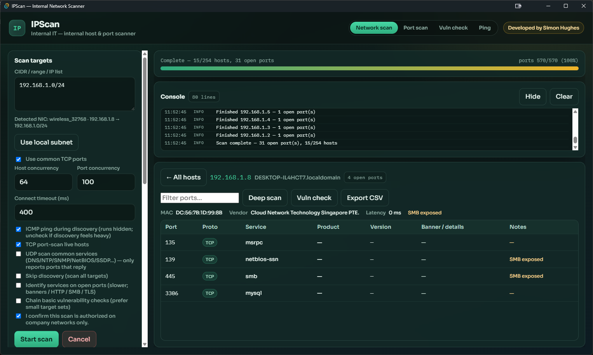
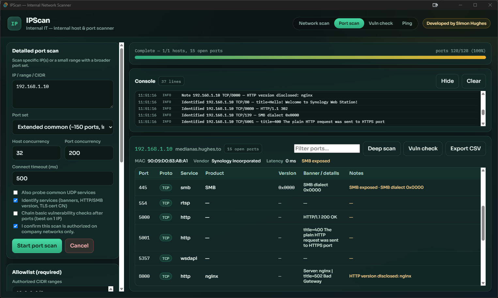
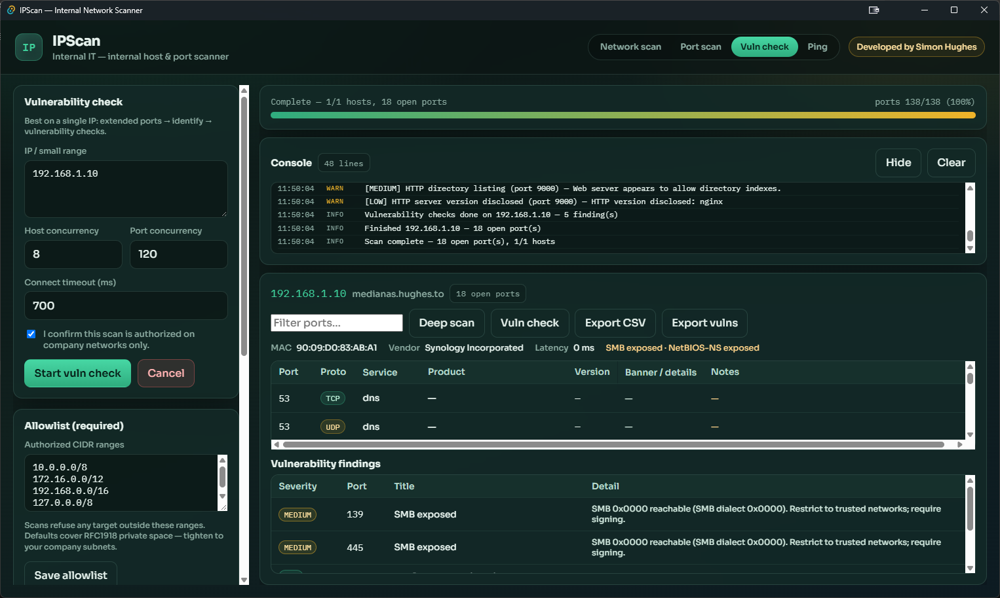
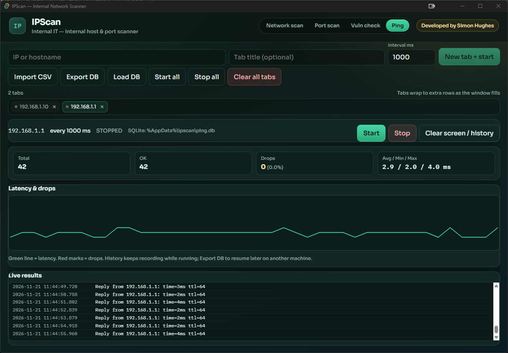

# IPScan

**Internal IT host & port scanner for Windows.**

IPScan helps IT and security teams discover live hosts, map open ports, run a lightweight exposure (vuln) pass, and continuously ping targets — all from one desktop app.

Built with **Tauri 2 + Rust + React**. Inspired by Angry IP Scanner / RustScan-style workflows, implemented as a greenfield app (not a GPL fork).

Developed by **Simon Hughes**.

---

## Modes at a glance

| Mode | Best for |
|------|----------|
| **Network scan** | Sweep a subnet/CIDR, find live hosts, optionally port-scan them |
| **Port scan** | Deep TCP (and optional UDP) scan of specific IPs with service ID |
| **Vuln check** | Extended ports → identify → basic exposure findings on a small set |
| **Ping** | Continuous ICMP tabs, CSV import, SQLite history & charts |

---

## Screenshots

### Network scan

Discover hosts on a LAN/CIDR (ARP-first on the local subnet), then optionally TCP-scan live hosts. Results include hostname, MAC/vendor, latency, open ports, and risk notes (e.g. SMB exposed).



**Typical flow**
1. Enter a CIDR / range / IP list, or click **Use local subnet**.
2. Tune host/port concurrency and connect timeout.
3. Confirm authorized use, then **Start scan**.
4. Click a host for its port table; use **Deep scan**, **Vuln check**, or **Export CSV**.

**Useful options**
- Common TCP ports vs skip discovery / scan all targets
- Hidden ICMP during discovery
- Optional UDP common services (only reports ports that reply)
- Identify services (banners / HTTP / SMB / TLS)
- Chain basic vulnerability checks

---

### Port scan

Focused deep scan on one IP or a small range. Choose a port preset (extended common, 1–1024, 1–10000, full 1–65535, or custom) and optionally identify services.



**Typical flow**
1. Enter IP / range / CIDR.
2. Pick a **Port set** and concurrency.
3. Enable **Identify services** when you need banners, HTTP titles, SMB dialect, TLS CN.
4. **Start port scan** → review console + port table → **Export CSV**.

---

### Vuln check

Lightweight exposure assessment (not OpenVAS / full CVE scanning). Prefer a **single IP** or tiny range: extended ports → identify → vulnerability-style findings with severity.



**Typical flow**
1. Enter a single IP (or very small range).
2. Confirm allowlist + authorized use.
3. **Start vuln check**.
4. Review the findings table (severity, title, detail) and **Export vulns** / CSV.

Findings are exposure-oriented (e.g. SMB reachable, HTTP version disclosed, directory listing) — useful triage for internal assessments, not a substitute for a dedicated vulnerability scanner.

---

### Ping

Browser-style tabs for continuous ICMP. Each tab records live replies, drop %, and latency charts. History is stored in SQLite so you can stop and resume later.



**Typical flow**
1. Enter an IP/hostname → **New tab + start** (fields clear for the next host).
2. Or **Import CSV** (one IP per line, or first column) to open many tabs and start them staggered.
3. Use **Start all** / **Stop all** for bulk control; tabs wrap to extra rows as the window fills.
4. **Export DB** / **Load DB** to back up or restore the full ping workspace (`%AppData%\ipscan\ping.db`).

**Per-tab controls:** Start, Stop, Clear screen / history. Green line = latency; red marks = drops.

---

## Features

- Host discovery over CIDR / IP ranges / lists (**ARP-first on LAN**, ICMP + broader TCP probes)
- Async TCP connect scanning with concurrency controls
- Dedicated **Port scan** mode with presets (extended common, 1–1024, 1–10000, full, custom)
- Optional **Identify services** (banners, HTTP Server/title/version, SMB dialect/signing, TLS cert CN)
- Optional **Vuln check** mode (lightweight exposure assessment)
- **Ping** mode — wrapping tabs, CSV import, Export/Load DB, latency/drop charts
- Optional UDP scan for common services (DNS/NTP/SNMP/NetBIOS/SSDP/…) — replies only
- Hostname via reverse DNS with **NetBIOS** fallback
- MAC via Windows ARP (**same L2/subnet only**) + manufacturer via embedded OUI DB (~52k vendors)
- Allowlist gate (targets must fall inside authorized CIDRs)
- Authorized-use confirmation before scan start
- Live results, filters, risk notes (RDP/SMB/Telnet/FTP, …)
- Saved scan profiles
- CSV / JSON export
- Local audit log (default `%AppData%\com.onyx.ipscan\audit.log`; path configurable via `HKCU\Software\Onyx\IPScan\AuditLogPath`)

---

## Prerequisites (Windows)

| Requirement | Notes |
|-------------|--------|
| **Node.js 20+** | Frontend tooling |
| **Rust stable** | Via [`rustup`](https://rustup.rs/) |
| **VS 2022 Build Tools** | *Desktop development with C++* workload |
| **WebView2 Runtime** | Usually preinstalled on Windows 10/11 |

---

## Develop

```bash
npm install
npm run tauri:dev
```

Do **not** double-click a debug `ipscan.exe` unless Vite is running (`npm run tauri:dev`). Dev builds expect `http://localhost:1420`.

---

## Build Windows installers

```bash
npm install
npm run tauri:build
```

Artifacts:

| Path | What it is |
|------|------------|
| `src-tauri/target/release/ipscan.exe` | Standalone exe (UI embedded) |
| `src-tauri/target/release/bundle/nsis/` | NSIS setup installer |
| `src-tauri/target/release/bundle/msi/` | MSI installer |

Always prefer `npm run tauri:build` for a runnable release binary.

---

## Data locations

| Data | Location |
|------|----------|
| Ping history / tabs | `%AppData%\ipscan\ping.db` |
| Audit log (default) | `%AppData%\com.onyx.ipscan\audit.log` |
| Audit path override | Registry `HKCU\Software\Onyx\IPScan\AuditLogPath` |

---

## CSV notes

- **Scan export:** one row per open port (not one row per host), with host metadata repeated for filtering in Excel.
- **Ping import:** one IP/hostname per line, or use the first CSV column (optional header: `ip` / `host` / `target`). Max 500 targets per import.

---

## Authorized use

This tool is intended for **authorized internal assessments only**.

1. Configure the **allowlist** to your company CIDRs.
2. Tick the authorization confirmation before starting a scan.
3. Do **not** point it at networks you do not own or administer.

Misuse against systems without permission may be illegal.

---

## Project layout

```
IPScan/
├── src/                 # React UI (modes, results, Ping)
├── src-tauri/           # Rust backend (scan, ping, SQLite, Tauri commands)
├── screenshots/         # README screenshots
└── package.json
```

---

## License

Add a license of your choice before publishing (e.g. MIT). Until then, all rights reserved by the author unless otherwise stated.
